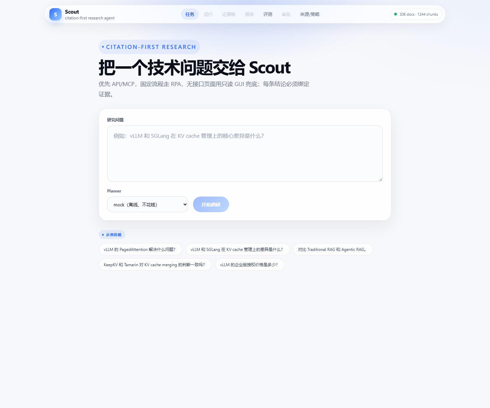
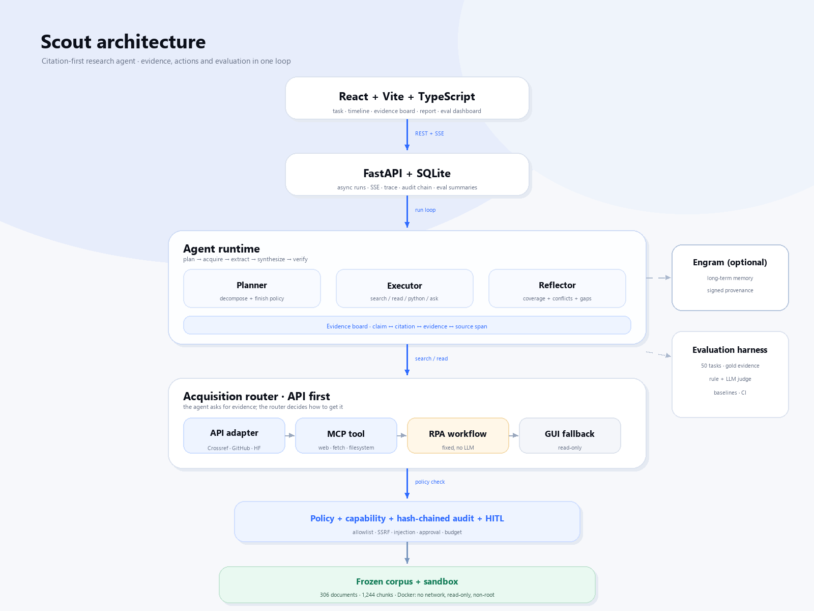

# Scout

**A citation-first AI technology research agent.**

[](#testing)
[](#quickstart)
[](#architecture)
[](#frontend)
[](#docker)
[](LICENSE)

<p align="center"><strong>English</strong> · <a href="README.zh-CN.md">简体中文</a></p>

Scout answers technical research questions over a frozen corpus of AI / Agent /
RecSys papers, documentation and repositories. It is not a chat wrapper around a
vector store: it treats **evidence acquisition, evidence quality and evidence
security** as the product.

**The thesis:** *every claim must be bound to a source span, every failure must be
reproducible, and every action must stay inside a capability boundary.*

<p align="center">
  
</p>

> A 3-minute walkthrough and talk track: [`docs/DEMO.md`](docs/DEMO.md).

> **Status:** 102 tests · 36 security cases · 50-task evaluation · Docker
> one-command deploy. Full 50 live evaluation (DeepSeek flash):
> **Scout 28/50 (56%) vs single-shot RAG 18/50 (36%)**.
> See [`docs/PHASES.md`](docs/PHASES.md) for the delivery log.

---

## Results

Scout is evaluated on 50 technical-research tasks across six categories. The live
run uses `deepseek-flash` with `max_steps=10`; the RAG baseline is offline and
extractive.

| System | Overall | Fact | Multi-hop | Comparison | Procedure | Conflict | Abstention |
|---|---:|---:|---:|---:|---:|---:|---:|
| **Scout live** | **28/50** | 7/10 | **7/15** | **7/10** | 1/5 | **2/5** | **4/5** |
| Single-shot RAG | 18/50 | 7/10 | 6/15 | 3/10 | 2/5 | 0/5 | 0/5 |
| Scout mock | 17/50 | 5/10 | 4/15 | 4/10 | 0/5 | 0/5 | 4/5 |

- citation support **94%**
- average **8.66** tool steps
- **27.3k** tokens per task
- p50 **39.9s**, p95 **77.4s**
- failure taxonomy: `missing_fact 17`, `missing_citation 2`, `over_abstention 2`,
  `over_answer 1`

Scout wins on **comparison**, **abstention**, **conflict** and **multi-hop**;
ties RAG on **fact**; still loses on **procedure**. That is the honest result,
and it is the reason the evaluation harness exists.

---

## What makes Scout different

### 1. Citation-first, not citation-decorated

Scout models evidence explicitly:

```text
Claim ──1:N── Citation ──1:1── Evidence ──1:1── SourceSpan
```

- every report claim must carry a citation;
- the quoted span must exist in the source document;
- `untrusted` sources cannot be the sole support for a claim;
- conflicts are surfaced as `conflicts`, not averaged away;
- gaps are explicit: what was not covered, why, and what evidence is missing.

### 2. Hybrid acquisition, API first

The agent only says “search” or “read”. The acquisition router decides how:

```text
API adapter → MCP tool → RPA workflow → read-only GUI fallback
```

- **API/MCP** for structured sources (Crossref, GitHub, HuggingFace, docs);
- **RPA** for stable repeated workflows;
- **GUI** only as a last resort, read-only: no clicks, no forms, no login.

Every source carries `source_type`, `trust`, `retrieval_method`, `content_hash`
and a policy verdict.

### 3. Evaluation is part of the product

- 50 tasks: fact, multi-hop, comparison, procedure, conflict, abstention;
- gold evidence spans, required citations, forbidden claims;
- rule grader + LLM judge + human calibration hooks;
- baselines: single-shot RAG, ReAct without reflection, Scout mock/Scout live;
- failure taxonomy, cost, latency and trace/replay.

### 4. Security is the boundary

- capability tokens: `sources:read`, `sandbox:exec`, `report:export`, ...
- domain allowlist + DNS/private-IP checks (SSRF);
- prompt-injection detection and untrusted-content marking;
- Python sandbox (Docker: no network, read-only root, non-root, resource limits);
- hash-chained audit ledger;
- HITL for risky actions, budget overruns and ambiguous scope.

### 5. A complete product, not a notebook

- FastAPI backend with async runs and SSE;
- React + Vite + TypeScript UI: task, timeline, evidence board, report, eval
  dashboard, approvals, sources/policy;
- SQLite persistence, replayable traces, Docker Compose deployment.

---

## Architecture

<p align="center">
  
</p>

<details>
<summary>Text version</summary>

```text
React + Vite + TypeScript
        │ REST + SSE
FastAPI / SQLite
        │
Agent runtime
  Intake → Clarify → Plan → Acquire → Extract → Synthesize
         → Verify → (Replan | Finish | Escalate)
        │
Acquisition router
  API adapter → MCP tool → RPA workflow → read-only GUI
        │
Policy + capability tokens + hash-chained audit + HITL
        │
Frozen corpus + sandbox (Python/Docker) + source allowlist
```

</details>

The runtime is framework-free: the loop, tools, evidence board, scheduler and
evaluator are plain Python, so they can be tested and replayed without a
framework dependency.

### Relationship to Engram

- **Engram** is the trustworthy long-term memory layer.
- **Scout** is the trustworthy evidence and research layer.
- Scout can optionally use Engram for project memory, user preferences and
  signed provenance; the core evaluation does not depend on it.

Scout is the P0 integration promised in Engram’s roadmap: a Deep Research Agent
using the memory layer.

---

## Quickstart

**Requirements:** Python 3.10+, Node 22+ (frontend build), Docker Desktop
(optional deployment). The frozen corpus (~306 documents) is included.

### Docker (recommended)

```bash
cd D:\scout
cp .env.example .env     # skip if .env already exists; add a key for live planning
docker compose up --build
```

Open **http://127.0.0.1:8000**.

The container:

- builds the React UI in a Node stage and copies `dist` to `/app/static`;
- installs the Python package and copies the frozen corpus + eval set;
- runs `init → ingest → uvicorn` on startup;
- mounts `./data` for SQLite;
- exposes a `/health` healthcheck.

The image does **not** bake `.env`; Compose passes it at runtime. Never commit a
real key.

### Local development

```bash
cd D:\scout
python -m venv .venv
.venv\Scripts\activate

cd backend
pip install -e ".[dev]"
python -m scout.cli init
python -m scout.cli ingest
python -m scout.cli serve --host 127.0.0.1 --port 8000
```

In a second terminal:

```bash
cd D:\scout\frontend
npm install
npm run dev
```

Open **http://127.0.0.1:5173**; Vite proxies `/v1` and `/health` to the backend.

### Rebuild the corpus (optional)

```bash
cd D:\scout
python scripts/fetch_corpus.py \
  --only crossref,github,hf,docs \
  --max-docs 350 --per-query 25 \
  --with-readmes --max-readmes 30
```

---

## Configuration

Copy `.env.example` to `.env`. The important variables:

| Variable | Default | Meaning |
|---|---|---|
| `DEEPSEEK_API_KEY` | empty | provider key; never commit |
| `DEEPSEEK_BASE_URL` | `https://api.deepseek.com` | OpenAI-compatible base |
| `SCOUT_ALLOWED_MODELS` | `deepseek-flash` | model allowlist; `deepseek-v4-pro` is rejected |
| `SCOUT_LLM_MODE` | `mock` | `mock` (offline) or `live` |
| `SCOUT_EMBEDDING_PROVIDER` | `hash` | `hash` (deterministic) or `fastembed` |
| `SCOUT_DB_PATH` | `./data/scout.db` | SQLite database |
| `SCOUT_CORPUS_DIR` | `./corpus` | frozen corpus |
| `SCOUT_MAX_STEPS` | `25` | per-run step budget |
| `SCOUT_TOKEN_BUDGET` | `60000` | per-run token budget |
| `SCOUT_VERIFY_DNS` | `true` | reject private/reserved IPs (SSRF) |
| `SCOUT_SANDBOX_BACKEND` | `disabled` | `disabled`, `subprocess` (weak), or `docker` (strong) |
| `SCOUT_REQUIRE_AUTH` | `false` | API key auth (loopback dev only) |

Relative paths are resolved against the project root, not the current working
directory. Full list: [`.env.example`](.env.example).

---

## Evaluation

```bash
cd D:\scout\backend

# Offline baselines (no LLM spend)
python -m scout.cli eval --system single_shot_rag --planner mock \
  --out reports/eval_rag_full.md
python -m scout.cli eval --system scout --planner mock \
  --out reports/eval_scout_mock_full.md

# Live Scout (DeepSeek flash); full 50 takes ~35–45 min, ~1.37M tokens
python -m scout.cli eval --system scout --planner deepseek \
  --out reports/eval_scout_deepseek_full.md

# Only the 20 held-out tasks
python -m scout.cli eval --system scout --planner deepseek --split heldout \
  --out reports/eval_heldout.md
```

Each run also writes `.json` summary and `.details.json` per-task results. The
`--split dev|heldout|all` flag keeps prompt tuning away from the held-out set.

Reports are written to `reports/` as Markdown + JSON summaries; the UI eval
dashboard reads the JSON files.

Details: [`docs/EVALUATION.md`](docs/EVALUATION.md).

---

## Security

- **SSRF**: scheme/credentials/port checks, DNS resolution, private/metadata IP
  rejection.
- **Prompt injection**: untrusted content is marked as data, never instructions;
  injection patterns are detected and logged.
- **Secrets**: keys live only in `.env`; audit strings are redacted; traces hold
  fingerprints rather than payloads.
- **Sandbox**: Docker isolation (`--network none`, read-only root, `--cap-drop
  ALL`, non-root, CPU/memory/PID limits). `subprocess` is development-only and
  explicitly weak.
- **Audit**: per-tenant SHA-256 hash chain; `scout verify-ledger` detects edits.
- **HITL**: risky actions, budget overruns and ambiguous scope go through an
  approval gate.

36 security cases pass. Full threat model:
[`docs/SECURITY.md`](docs/SECURITY.md).

> ⚠️ Do not run host CLI evals against the same `data/scout.db` while the Docker
> container is running. Concurrent SQLite writes through a Windows bind mount
> corrupted the DB once. Stop the container (`docker compose down`) or use a
> separate `SCOUT_DB_PATH` for host evals.

---

## Project structure

```text
backend/
  src/scout/
    agent/          state, planner, reflector, tools, loop, synthesis
    acquisition/    API adapters, MCP client, RPA workflows, read-only GUI
    policy/         capability, allowlist/SSRF, injection detection
    sandbox/        Python + GUI sandbox boundaries
    eval/           50-task runner, graders, metrics, baselines, report
    api.py          FastAPI + SSE
    cli.py          init / ingest / index / search / run / eval / serve
frontend/           React + Vite + TypeScript UI
corpus/             frozen corpus + manifest
eval/tasks.json     50 tasks with gold evidence
docs/               design, security, evaluation, phases, demo, blog
scripts/            corpus acquisition
reports/            eval reports (generated)
```

---

## Testing

```bash
cd D:\scout\backend
pytest -q          # 102 tests
ruff check src tests
mypy src/scout
```

CI is defined in [`.github/workflows/ci.yml`](.github/workflows/ci.yml):
backend tests + lint, frontend build, Docker build.

---

## Resume bullets (measured)

- Built **Scout**, a citation-first AI research agent: FastAPI + React/SSE +
  SQLite, five tools, evidence board, capability policy, hash-chained audit;
  **102 tests** and **36 security cases** pass.
- Designed hybrid acquisition routing **API → MCP → RPA → read-only GUI** with
  SSRF/allowlist, prompt-injection marking, Docker sandbox boundary and HITL.
- Built a **50-task** evaluation set (fact / multi-hop / comparison / procedure /
  conflict / abstention) with rule + LLM grading and baselines; full live Scout
  **28/50 (56%) vs RAG 18/50 (36%)**, better on comparison (7/10 vs 3/10),
  abstention (4/5 vs 0/5), conflict (2/5 vs 0/5) and multi-hop (7/15 vs 6/15).
- Delivered a complete React + FastAPI product with live SSE timeline, evidence
  board, citation-bound report, eval dashboard and approval view; Dockerfile and
  Compose included.

---

## Known limitations

- **Procedure** is still weak (1/5 vs 2/5); the agent tends to concatenate
  evidence instead of restructuring it into steps.
- **Conflict** coverage is 2/5; multi-source disagreement still relies on prompt
  guidance plus a small heuristic.
- **Cost/latency**: ~27k tokens and ~40s p50 per task; one comparison task had a
  long retry outlier (category p95 ~659s).
- **fastembed** is installed and tested but not default: CPU index build is slow
  and its Chinese-query ranking was mixed on this corpus.
- Docker is verified locally; the GitHub Actions workflow is written but has not
  run in a remote CI environment yet. GUI and real MCP servers are not exercised
  live.
- `SCOUT_SANDBOX_BACKEND=subprocess` is weak isolation; use `docker` for the
  strong boundary.

---

## Roadmap

- [ ] Improve procedure synthesis and conflict coverage.
- [ ] Run full 50 live with multiple seeds and publish variance.
- [ ] Add fastembed index caching + title/entity reranking.
- [ ] Connect a real MCP server and exercise the GUI fallback in CI.
- [ ] Ed25519 attestations + external audit anchoring.
- [ ] Remote CI green + a Docker smoke test in CI.

---

## Non-goals

- a general-purpose chatbot;
- a multi-agent platform;
- a general web-browsing agent;
- fine-tuning or RL;
- production-scale distributed infrastructure.

---

## Docs

- [Design](docs/DESIGN.md)
- [API](docs/API.md)
- [Security](docs/SECURITY.md)
- [Evaluation](docs/EVALUATION.md)
- [Phases and delivery log](docs/PHASES.md)
- [3-minute demo](docs/DEMO.md)
- [Technical blog draft](docs/BLOG.md)
- [Frontend](frontend/README.md)

---

## License

MIT. See [LICENSE](LICENSE).
