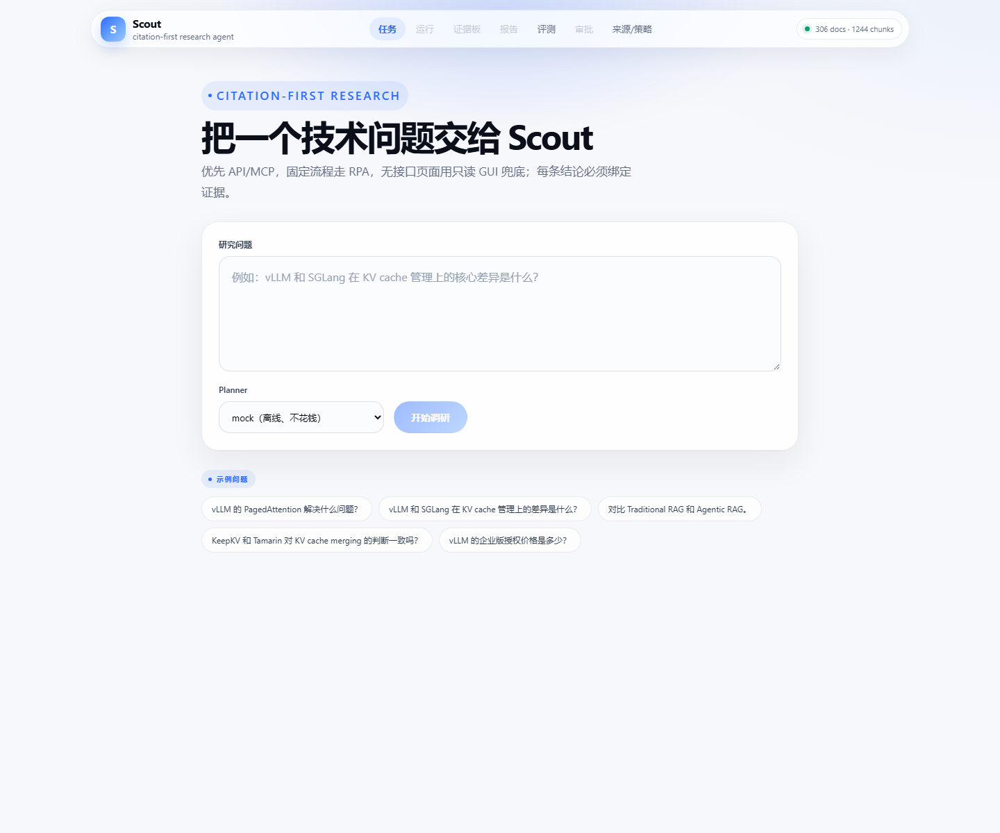
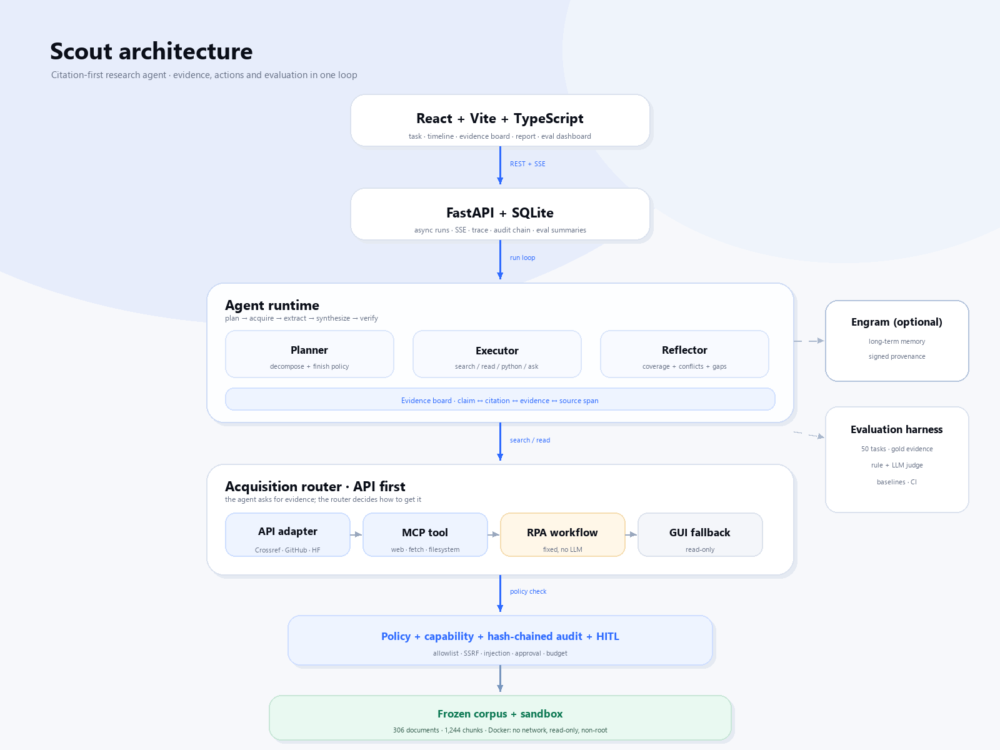

# Scout

**一个 citation-first 的 AI 技术调研 Agent。**

[](#测试)
[](#快速开始)
[](#架构)
[](#前端)
[](#docker)
[](LICENSE)

<p align="center"><a href="README.md">English</a> · <strong>简体中文</strong></p>

Scout 在一个冻结的 AI / Agent / RecSys 语料上回答技术调研问题。它不是“给向量库套一个聊天壳”，而是把**证据获取、证据质量、证据安全**当作产品本身。

**核心主张：** *每个结论都必须绑定 source span，每次失败都必须可复现，每个动作都必须待在 capability 边界内。*

<p align="center">
  
</p>

> 3 分钟演示脚本和讲解词：[`docs/DEMO.md`](docs/DEMO.md)。

> **状态：** 102 tests · 36 security cases · 50 题评测 · Docker 一条命令部署。
> Full 50 live（DeepSeek flash）：**Scout 28/50（56%）vs single-shot RAG 18/50（36%）**。
> 交付记录见 [`docs/PHASES.md`](docs/PHASES.md)。

---

## 评测结果

50 道技术调研任务，覆盖 6 类。Live 运行使用 `deepseek-flash`、`max_steps=10`；RAG baseline 是离线 extractive。

| 系统 | 总体 | Fact | Multi-hop | Comparison | Procedure | Conflict | Abstention |
|---|---:|---:|---:|---:|---:|---:|---:|
| **Scout live** | **28/50** | 7/10 | **7/15** | **7/10** | 1/5 | **2/5** | **4/5** |
| Single-shot RAG | 18/50 | 7/10 | 6/15 | 3/10 | 2/5 | 0/5 | 0/5 |
| Scout mock | 17/50 | 5/10 | 4/15 | 4/10 | 0/5 | 0/5 | 4/5 |

- citation support **94%**
- 平均 **8.66** 个工具步骤
- 每任务 **27.3k** tokens
- p50 **39.9s**，p95 **77.4s**
- 失败分类：`missing_fact 17`、`missing_citation 2`、`over_abstention 2`、
  `over_answer 1`

Scout 在 **comparison、abstention、conflict、multi-hop** 上更好，fact 与 RAG 持平，procedure 仍落后。这是诚实的评测结果，也是评测 harness 存在的意义。

---

## Scout 的不同之处

### 1. Citation-first，而不是“答案后面加链接”

Scout 显式建模证据：

```text
Claim ──1:N── Citation ──1:1── Evidence ──1:1── SourceSpan
```

- 报告中每个 claim 必须带 citation；
- 引用的 quote 必须能在源文档中找到；
- `untrusted` 来源不能单独支撑关键结论；
- 冲突进入 `conflicts`，不会被静默平均；
- 缺口显式列出：哪些子问题没覆盖、为什么、还缺什么证据。

### 2. 混合获取，API 优先

Agent 只说“查/读”，具体怎么获取由 acquisition router 决定：

```text
API adapter → MCP tool → RPA workflow → read-only GUI fallback
```

- **API/MCP**：Crossref、GitHub、HuggingFace、官方文档等结构化来源；
- **RPA**：稳定、重复的固定流程；
- **GUI**：最后兜底，只读——不点击、不填表、不登录。

每条来源都记录 `source_type`、`trust`、`retrieval_method`、`content_hash` 和 policy verdict。

### 3. 评测是产品的一部分

- 50 题：fact、multi-hop、comparison、procedure、conflict、abstention；
- gold evidence span、required citations、forbidden claims；
- rule grader + LLM judge + 人工校准接口；
- baseline：single-shot RAG、无反思 ReAct、Scout mock / Scout live；
- 失败分类、成本、延迟、trace/replay。

### 4. 安全是边界

- capability token：`sources:read`、`sandbox:exec`、`report:export` 等；
- 域名 allowlist + DNS/私网 IP 检查（SSRF）；
- prompt-injection 检测 + untrusted 内容标记；
- Python sandbox（Docker：无网络、只读 root、非 root、资源限制）；
- 哈希链审计日志；
- 高风险动作、预算超限、模糊请求走 HITL。

### 5. 完整产品，不是 notebook

- FastAPI 后端：async run + SSE；
- React + Vite + TypeScript 前端：任务、时间线、证据板、报告、评测面板、审批、来源/策略；
- SQLite 持久化、可回放 trace、Docker Compose 部署。

---

## 架构

<p align="center">
  
</p>

<details>
<summary>文字版</summary>

```text
React + Vite + TypeScript
        │ REST + SSE
FastAPI / SQLite
        │
Agent runtime
  Intake → Clarify → Plan → Acquire → Extract → Synthesize
         → Verify → (Replan | Finish | Escalate)
        │
Acquisition router
  API adapter → MCP tool → RPA workflow → read-only GUI
        │
Policy + capability tokens + hash-chained audit + HITL
        │
Frozen corpus + sandbox (Python/Docker) + source allowlist
```

</details>

Runtime 不依赖框架：loop、tools、evidence board、scheduler、evaluator 都是 plain Python，方便测试和 replay。

### 与 Engram 的关系

- **Engram** 是可信长期记忆层；
- **Scout** 是可信证据与研究层；
- Scout 可选使用 Engram 存项目记忆、用户偏好和 signed provenance；核心评测不依赖 Engram。

Scout 也是 Engram roadmap 里的 P0 integration：一个使用 memory layer 的 Deep Research Agent。

---

## 快速开始

**环境要求：** Python 3.10+、Node 22+（前端构建）、Docker Desktop（可选部署）。冻结语料（约 306 篇）已包含在仓库里。

### Docker（推荐）

```bash
cd D:\scout
cp .env.example .env     # 已有 .env 则跳过；要 live planner 才需要 key
docker compose up --build
```

打开 **http://127.0.0.1:8000**。

容器会：

- 在 Node stage 构建 React UI，把 `dist` 复制到 `/app/static`；
- 安装 Python 包，复制冻结语料 + eval set；
- 启动时执行 `init → ingest → uvicorn`；
- 挂载 `./data` 作为 SQLite；
- 暴露 `/health` healthcheck。

镜像**不会**打包 `.env`；Compose 在运行时注入。不要把真实 key 提交到 git。

### 本地开发

```bash
cd D:\scout
python -m venv .venv
.venv\Scripts\activate

cd backend
pip install -e ".[dev]"
python -m scout.cli init
python -m scout.cli ingest
python -m scout.cli serve --host 127.0.0.1 --port 8000
```

另开终端：

```bash
cd D:\scout\frontend
npm install
npm run dev
```

打开 **http://127.0.0.1:5173**；Vite 会把 `/v1` 和 `/health` 代理到后端。

### 重新抓取语料（可选）

```bash
cd D:\scout
python scripts/fetch_corpus.py \
  --only crossref,github,hf,docs \
  --max-docs 350 --per-query 25 \
  --with-readmes --max-readmes 30
```

---

## 配置

复制 `.env.example` 为 `.env`。关键变量：

| 变量 | 默认 | 含义 |
|---|---|---|
| `DEEPSEEK_API_KEY` | 空 | provider key；不要提交 |
| `DEEPSEEK_BASE_URL` | `https://api.deepseek.com` | OpenAI-compatible base |
| `SCOUT_ALLOWED_MODELS` | `deepseek-flash` | 模型 allowlist；`deepseek-v4-pro` 会被拒绝 |
| `SCOUT_LLM_MODE` | `mock` | `mock`（离线）或 `live` |
| `SCOUT_EMBEDDING_PROVIDER` | `hash` | `hash`（确定性）或 `fastembed` |
| `SCOUT_DB_PATH` | `./data/scout.db` | SQLite |
| `SCOUT_CORPUS_DIR` | `./corpus` | 冻结语料 |
| `SCOUT_MAX_STEPS` | `25` | 每 run 最大步数 |
| `SCOUT_TOKEN_BUDGET` | `60000` | 每 run token 预算 |
| `SCOUT_VERIFY_DNS` | `true` | 拒绝私网/保留 IP（SSRF） |
| `SCOUT_SANDBOX_BACKEND` | `disabled` | `disabled`、`subprocess`（弱）、`docker`（强） |
| `SCOUT_REQUIRE_AUTH` | `false` | API key 认证（仅 loopback 开发） |

相对路径按项目根解析，不按当前工作目录。完整列表：[`.env.example`](.env.example)。

---

## 评测

```bash
cd D:\scout\backend

# 离线 baseline（不花钱）
python -m scout.cli eval --system single_shot_rag --planner mock \
  --out reports/eval_rag_full.md
python -m scout.cli eval --system scout --planner mock \
  --out reports/eval_scout_mock_full.md

# Live Scout（DeepSeek flash）；full 50 约 35–45 分钟，~1.37M tokens
python -m scout.cli eval --system scout --planner deepseek \
  --out reports/eval_scout_deepseek_full.md

# 只跑 20 题 held-out
python -m scout.cli eval --system scout --planner deepseek --split heldout \
  --out reports/eval_heldout.md
```

每次评测同时写 `.json` summary 和 `.details.json` 逐题结果；
`--split dev|heldout|all` 用于把 prompt 调优和 held-out 分开。

报告写到 `reports/`，包含 Markdown + JSON summary；前端评测面板读取 JSON。

细节：[`docs/EVALUATION.md`](docs/EVALUATION.md)。

---

## 安全

- **SSRF**：scheme/credentials/port 检查、DNS 解析、私网/元数据 IP 拦截。
- **Prompt injection**：untrusted 内容只当数据，不当指令；注入模式检测并记录。
- **密钥**：只放 `.env`；审计字符串脱敏；trace 存 fingerprint 而不是 payload。
- **沙箱**：Docker 隔离（`--network none`、只读 root、`--cap-drop ALL`、非 root、CPU/内存/PID 限制）。`subprocess` 仅开发模式，明确是弱隔离。
- **审计**：per-tenant SHA-256 hash chain；`scout verify-ledger` 检测篡改。
- **HITL**：高风险动作、预算超限、模糊范围走审批门。

36 个安全用例通过。完整威胁模型：[`docs/SECURITY.md`](docs/SECURITY.md)。

> ⚠️ 不要在 Docker 容器运行时用 host CLI 评测同一个 `data/scout.db`。Windows bind mount 上的并发 SQLite 写曾经损坏过 DB。先 `docker compose down`，或给 host eval 设置独立的 `SCOUT_DB_PATH`。

---

## 项目结构

```text
backend/
  src/scout/
    agent/          state, planner, reflector, tools, loop, synthesis
    acquisition/    API adapters, MCP client, RPA workflows, read-only GUI
    policy/         capability, allowlist/SSRF, injection detection
    sandbox/        Python + GUI sandbox boundaries
    eval/           50-task runner, graders, metrics, baselines, report
    api.py          FastAPI + SSE
    cli.py          init / ingest / index / search / run / eval / serve
frontend/           React + Vite + TypeScript UI
corpus/             冻结语料 + manifest
eval/tasks.json     50 题 + gold evidence
docs/               design, security, evaluation, phases, demo, blog
scripts/            语料抓取
reports/            评测报告（生成）
```

---

## 测试

```bash
cd D:\scout\backend
pytest -q          # 102 tests
ruff check src tests
mypy src/scout
```

CI 定义在 [`.github/workflows/ci.yml`](.github/workflows/ci.yml)：后端测试 + lint、前端 build、Docker build。

---

## 简历 bullet（实测数字）

- 构建 **Scout**，一个 citation-first 的 AI 技术调研 Agent：FastAPI + React/SSE + SQLite、5 个工具、证据板、capability policy、哈希链审计；**102 tests**、**36 security cases** 通过。
- 设计混合获取路由 **API → MCP → RPA → read-only GUI**，包含 SSRF/allowlist、prompt-injection 标记、Docker 沙箱边界和 HITL。
- 构建 **50 题**评测集（fact / multi-hop / comparison / procedure / conflict / abstention），规则 + LLM grader + baseline；full live Scout **28/50（56%）vs RAG 18/50（36%）**，comparison（7/10 vs 3/10）、abstention（4/5 vs 0/5）、conflict（2/5 vs 0/5）、multi-hop（7/15 vs 6/15）更好。
- 交付完整 React + FastAPI 产品：实时 SSE 时间线、证据板、citation-bound 报告、评测面板、审批页；包含 Dockerfile 和 Compose。

---

## 已知限制

- **Procedure** 仍弱（1/5 vs 2/5）：Agent 倾向拼接证据，而不是按步骤重组。
- **Conflict** 2/5：多源观点冲突仍依赖 prompt + 小启发式。
- **成本/延迟**：每任务约 27k tokens、p50 约 40s；有一个 comparison 题长尾重试（分类 p95 ~659s）。
- **fastembed** 已安装测试但不设默认：CPU 建索引慢，中文 query 排序在该语料上不稳定。
- Docker 本地验证通过；GitHub Actions 已写但尚未在远程 CI 实跑；GUI 和真实 MCP server 未做 live 验证。
- `SCOUT_SANDBOX_BACKEND=subprocess` 是弱隔离；强边界请用 `docker`。

---

## Roadmap

- [ ] 改进 procedure synthesis 和 conflict coverage。
- [ ] 用多个 seed 跑 full 50 live，并发布方差。
- [ ] 加 fastembed 索引缓存 + title/entity reranking。
- [ ] 接入真实 MCP server，并在 CI 里跑 GUI fallback。
- [ ] Ed25519 attestations + external audit anchoring。
- [ ] 远程 CI 变绿 + CI 内 Docker smoke。

---

## 非目标

- 通用聊天助手；
- 多 Agent 平台；
- 任意网站的通用浏览器 Agent；
- 微调 / RL；
- 生产级分布式基础设施。

---

## 文档

- [设计](docs/DESIGN.md)
- [API](docs/API.md)
- [安全](docs/SECURITY.md)
- [评测](docs/EVALUATION.md)
- [阶段与交付记录](docs/PHASES.md)
- [3 分钟演示](docs/DEMO.md)
- [技术博客草稿](docs/BLOG.md)
- [前端](frontend/README.md)

---

## License

MIT。见 [LICENSE](LICENSE)。
